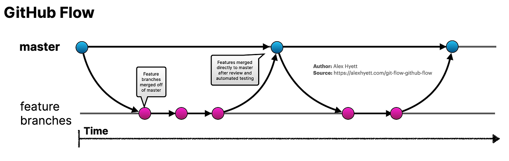

# 2026 SWA - Commit Convention

---

<aside>

#### 🪄Git Branch Strategy : Github Flow

> [**GitHub Flow](https://guides.github.com/introduction/flow/)는 GitHub에서 제안한 브랜치 모델로, 간단하고 빠른 개발을 위한 방법**
> 



**참고자료:** [사례로 이해하는 GitHub Flow](http://heropy.dev/p/6hdJi6)

---

- 단일 핵심 브랜치(**`main`**) 사용
- 기타 개발은 핵심 브랜치로부터 분기된 브랜치에서 진행하고 빠르게 병합
- Pull Request를 통해 코드 검토 후 병합

---

- 예시
    
    `feature-x` 브랜치에서 기능 개발 작업을 마친 후 해당 브랜치를 원격 저장소에 푸시
    
    ```java
    # main 브랜치로 이동
    git switch main
    
    # feature-x 브랜치 생성 및 이동
    git switch -c feature/count
    ```
    
    푸시 이후 GitHub 저장소의 [Pull Requests] 페이지로 이동하여, Pull Request(PR) 생성을 진행
    
</aside>

<aside>

#### 🪄Branch Naming Rule

- **kebab-case 활용**
- **기능 중심 작성**

```java
형식 : <작업유형(type)>/<기능명 또는 이슈 키워드(description)>
예시 : feature/user-login, fix/null-pointer ...
```

| 타입 | 용도 | 예시 |
| --- | --- | --- |
| `feature` | 새로운 기능 개발 | `feature/user-login` |
| `fix` | 버그 수정 | `fix/null-pointer` |
| `hotfix` | 운영 중 긴급 수정 | `hotfix/login-failure` |
| `docs` | 문서 수정 | `docs/readme-update` |
| `refactor` | 리팩토링 | `refactor/auth-service` |
| `test` | 테스트 코드 | `test/user-service` |
| `chore` | 빌드, 설정 변경 | `chore/github-actions` |
| `build` | 빌드 시스템 변경 | `build/gradle-upgrade` |
| `ci` | CI/CD 수정 | `ci/jenkins-pipeline` |
</aside>

<aside>

#### 🪄Commit Convention

> commit convention은 Conventional commit을 따른다
> 

[https://github.com/conventional-commits/conventionalcommits.org](https://github.com/conventional-commits/conventionalcommits.org)

```bash
<타입>[적용 범위(선택 사항)]: <설명> # ":" 이후에 <sapce>가 들어감에 유의!!
																		# 본문은 항상 빈 행으로 시작
[본문(선택 사항)]

[꼬리말(선택 사항)]
```

> 프로젝트의 커밋 메시지는 일관성과 가독성을 유지하기 위해 아래의 커밋 태그로 제한한다.
> 

태그를 제한함으로써 커밋 목적을 명확하게 표현하고, 불필요하게 다양한 태그 사용으로 인한 혼란을 방지하며, 협업 과정에서 변경 이력을 쉽게 이해하고 관리할 수 있도록 한다.

| 태그 | 용도 | 예시 |
| --- | --- | --- |
| `feat` | 새로운 기능 추가 | `feat: add cronjob scheduler` |
| `fix` | 버그 수정 | `fix: prevent duplicate job creation` |
| `docs` | 문서 수정 | `docs: add branch convention` |
| `refactor` | 기능 변경 없는 코드 구조 개선 | `refactor: extract carbon api client` |
| `test` | 테스트 코드 추가·수정 | `test: add scheduler unit tests` |
| `chore` | 기타 유지보수 작업 | `chore: update gitignore` |
| `build` | 빌드 시스템·의존성 변경 | `build: update go dependencies` |
| `ci` | GitHub Actions 등 CI/CD 설정 변경 | `ci: add pull request workflow` |
- 모든 커밋은 `feat`, `fix` 같은 명사로 된 접두어를 포함해야 하고 그 뒤로 선택 사항인 적용 범위, 선택 사항인 `!`, 그리고 필수인 `:`과 공백이 있어야 합니다.
- 적용 범위는 타입 다음에 기술하는데 이는 코드베이스가 적용되는 영역을 기술하는 명사로 괄호로 감싸져야 합니다, 예를 들어, `fix(parser):`
- 설명은 타입/적용 범위 접두어 뒤에 있는 콜론(:)과 공백 다음에 작성되어야 합니다. 설명은 코드 변경 사항에 대한 짧은 요약입니다.
- 더 긴 커밋 본문은 짧은 설명 다음에 위치할 수 있으며 코드 변경 사항에 대한 추가적인 문맥적인 정보를 제공합니다. 본문은 반드시 설명 다음에 빈 행으로 시작해야 합니다.
</aside>

<aside>

#### 🪄PR Convention

> 모든 작업은 별도의 브랜치에서 진행하며, 작업이 완료되면 Pull Request를 통해 `main` 브랜치에 병합한다.
> 

Pull Request는 변경 사항을 공유하고 코드 리뷰를 진행하기 위한 단위이다. PR의 제목과 본문을 일정한 형식으로 작성하여 변경 목적과 검증 내용을 쉽게 파악할 수 있도록 한다.

**PR 생성 전 확인 사항**

- [ ]  작업 브랜치가 최신 `main` 브랜치의 변경 사항을 반영하고 있는지 확인한다.
- [ ]  하나의 PR에는 하나의 기능 또는 하나의 논리적 변경만 포함한다.
- [ ]  `.env`, 인증키, 비밀번호 등 민감한 정보가 포함되어 있지 않은지 확인한다.
- [ ]  관련 테스트가 정상적으로 통과하는지 확인한다.
- [ ]  디버깅 코드, 불필요한 주석 및 로그가 포함되어 있지 않은지 확인한다.

---

**PR 제목**

PR 제목은 커밋 메시지와 동일하게 Conventional Commits 형식을 따른다.

```bash
<타입>[적용 범위(선택 사항)]: <설명>
```

- 예시
    
    ```bash
    feat(scheduler): add carbon-aware job scheduling
    fix(api): handle unavailable carbon intensity response
    docs: add pull request convention
    refactor(controller): separate reconciliation logic
    ```
    

---

**PR 본문**

- 작업 내용
    - 구현하거나 수정한 내용을 작성한다.
    - 주요 변경 사항을 항목별로 작성한다.
- 테스트
    
    > 테스트 결과를 간략하게 기술
    > 
    - 로컬 환경에서 빌드가 정상적으로 완료되는지 확인
    - 기존 테스트가 정상적으로 통과하는지 확인
    - 추가된 기능에 대한 테스트 작성 및 실행
- 관련 이슈
    
    **Issue 연결**
    PR과 관련된 Issue가 있다면 PR 본문에 이슈 번호를 작성한다. 
    
    ```
    Closes #15
    Fixes #21
    Resolves #32
    ```
    
    `Closes`, `Fixes`, `Resolves` 키워드를 사용하면 PR이 병합될 때 연결된 Issue가 자동으로 종료
    
- 참고 자료
    - 화면 변경, 실행 결과 또는 로그 등 리뷰에 필요한 자료가 있다면 첨부
- 리뷰 요청 사항
    - 리뷰어가 집중해서 확인해야 할 부분이나 고민한 내용을 작성
</aside>

<aside>

#### 🪄Code review & PR merge

**코드 리뷰 규칙**

- 리뷰어는 코드의 동작, 가독성, 테스트 여부 및 프로젝트 컨벤션 준수 여부를 확인한다.
- 리뷰 의견은 코드와 개선 방향을 중심으로 작성한다.
- 리뷰 의견에 대한 수정 또는 답변이 완료된 후 Conversation을 Resolve한다.
- 작성자는 자신의 PR을 리뷰 없이 직접 병합하지 않는다.

| 표현 | 의미 |
| --- | --- |
| `P1` | 반드시 수정해야 하는 문제 |
| `P2` | 수정이 권장되는 문제 |
| `P3` | 선택적으로 반영할 수 있는 제안 |
| `Question` | 코드의 의도나 동작에 대한 질문 |
| `Nit` | 사소한 표현이나 스타일 개선 의견 |

---

**PR 병합 조건**

> 다음 조건을 모두 만족한 경우에만 PR을 병합
> 
- [ ]  최소 1명 이상의 Approve를 받았다.
- [ ]  요청된 수정 사항을 모두 반영했다.
- [ ]  모든 Conversation이 Resolve 상태이다.
- [ ]  빌드 및 테스트가 정상적으로 통과했다.
- [ ]  Merge Conflict가 존재하지 않는다.

---

**Merge 방식**

PR은 기본적으로 `Squash and merge` 방식으로 병합한다.

하나의 PR에서 발생한 여러 커밋을 하나의 커밋으로 정리하여 `main` 브랜치의 커밋 이력을 간결하게 유지한다.

Squash 커밋 메시지는 PR 제목을 기준으로 작성한다.

```bash
feat(scheduler): add carbon-aware job scheduling
```

PR 병합이 완료되면 작업 브랜치는 삭제한다.

</aside>